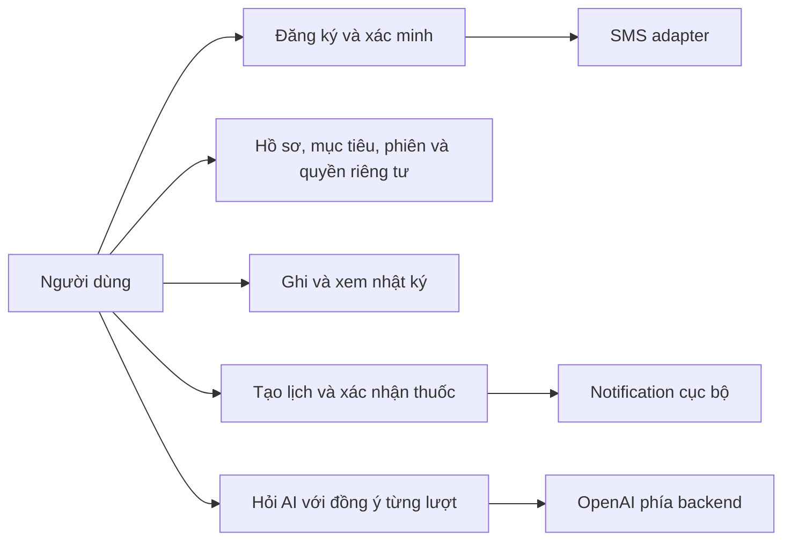
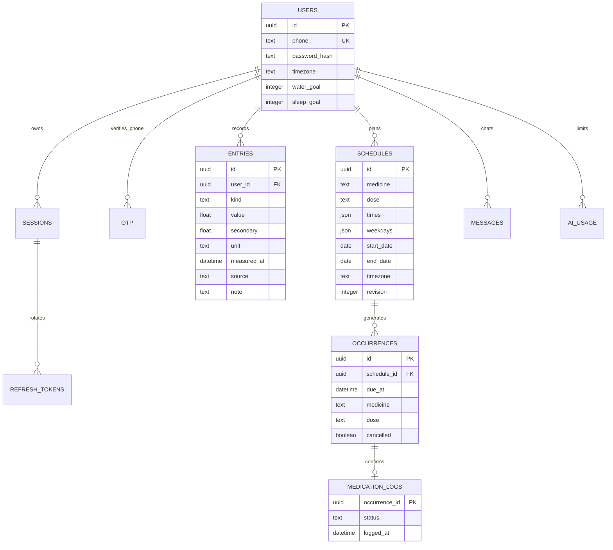
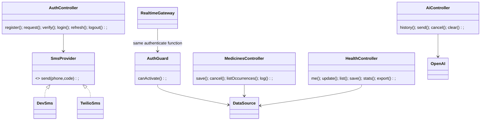
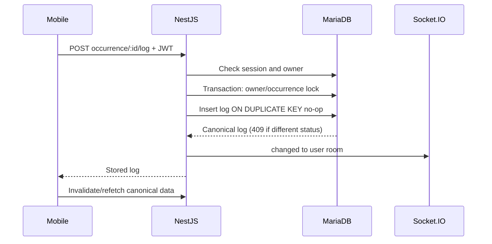

# SDS — kiến trúc và mô hình

## Kiến trúc
Expo Router → TanStack Query → HTTPS REST / Socket.IO → NestJS controllers → TypeORM DataSource/transactions → MariaDB 11.8 (InnoDB, utf8mb4). Quản lý database bằng HeidiSQL. Server gọi SMS adapter và OpenAI Responses API. SQL dùng placeholder `?`; không dùng ORM synchronize. Một tiến trình API cho môi trường đồ án; khóa AI đang xử lý nằm trong RAM, rate limits và usage ở MariaDB.

## Use case

## ERD

UUID được lưu CHAR(36) ASCII/case-sensitive; thời điểm tuyệt đối là DATETIME(3) UTC. OTP: phone FK tới users.phone + purpose + HMAC hash + expires_at + attempts + used. Rate limits có rate_key, bộ đếm và expires_at. Khóa duy nhất `(schedule_id,due_at)` và `medication_logs.occurrence_id` bảo vệ xác nhận trùng. Composite FK `(schedule_id,user_id)` bảo đảm occurrence thuộc đúng chủ lịch; các FK dữ liệu cá nhân dùng ON DELETE CASCADE. Medication snapshot giữ lịch sử qua lần sửa. Index owner/time cho entries, occurrences, messages; phone/purpose/time cho OTP; owner/revoked/expiry cho session. CHECK bảo vệ unit/value/status, giới hạn mục tiêu và ngày lịch ở tầng database.

## Class/module

## Sequence xác nhận thuốc

## Thời gian và notification
UTC cho thời điểm tuyệt đối; IANA cho thống kê/ngày và lịch lặp. Weekdays dùng ISO 1=thứ Hai, 7=Chủ nhật. Giờ DST không tồn tại được bỏ qua; giờ trùng chọn thời điểm đầu. Lịch có timezone riêng: đổi profile chỉ đổi nhóm thống kê, không âm thầm đổi giờ thuốc; sửa timezone của lịch là thao tác tường minh.

Occurrence được tạo khi fetch trong rolling window; không có scheduler nền server trong bản local. Thiết bị lên lịch DATE trigger trước 14 ngày, tối đa 60 lần, cập nhật khi mutation/realtime/reconnect/foreground và mỗi phút khi tab hoạt động. Không có push server nên không trùng local/push. Notification không phải cam kết chính xác tới giây; hệ điều hành, pin, permission ảnh hưởng. Thiết bị khác đang tắt app có thể còn lịch cũ tới lúc mở lại, giới hạn phải nêu khi demo.

## Bảo mật/local
- Argon2id; JWT 10 phút có issuer/audience, kiểm tra session ở mọi request. Refresh ngẫu nhiên 48 bytes, SHA256 hash, rotation transactional; reuse thu hồi session, gồm mọi token con. Phiên hết hạn sau 30 ngày tuyệt đối.
- OTP crypto RNG 6 số ở SMS thật, HMAC pepper, 5 phút, tối đa 5 lần, mỗi số 1 lần/phút và 10 lần/ngày, rate limit IP. Dev OTP cố định chỉ khi bật rõ, không log/đưa vào API response, bị cấm production.
- Socket không nhận room từ client; server chọn user/session room. JWT/session kiểm tra khi kết nối, revoke disconnect ngay, giới hạn kết nối 10 phút rồi refresh/reconnect. Không truyền nội dung sức khỏe trong sự kiện.
- RAM query cache, SecureStore token trên native; web demo chỉ giữ token RAM. Logout/đổi tài khoản hủy query, xóa cache và notification. Không triển khai offline mutations hoặc lưu health data không mã hóa.
- Export tệp tạm do người dùng yêu cầu, xóa trong finally sau hộp thoại chia sẻ; bản đã lưu/chia sẻ do người dùng quản lý. Không log payload. DB local/backup chưa mã hóa bởi app; cần kiểm soát máy và ổ đĩa.
- LAN HTTP chỉ cho thử nghiệm trên mạng tin cậy. Kết nối ngoài máy phát triển cần reverse proxy TLS, secret manager, database TLS/backups, audit policy và kiểm tra bảo mật. Không triển khai production.
- AI: không có tools/action mutation, chỉ gửi tối thiểu summary khi đồng ý, `store:false`, timeout 30s, tối đa 5 lượt/phút và cấu hình lượt/ngày UTC. Không log lỗi upstream hoặc response body. Chưa streaming; UI chờ/hủy/thử lại. Prompt là biện pháp hạn chế hành vi, không bảo đảm đầu ra y khoa luôn đúng.
